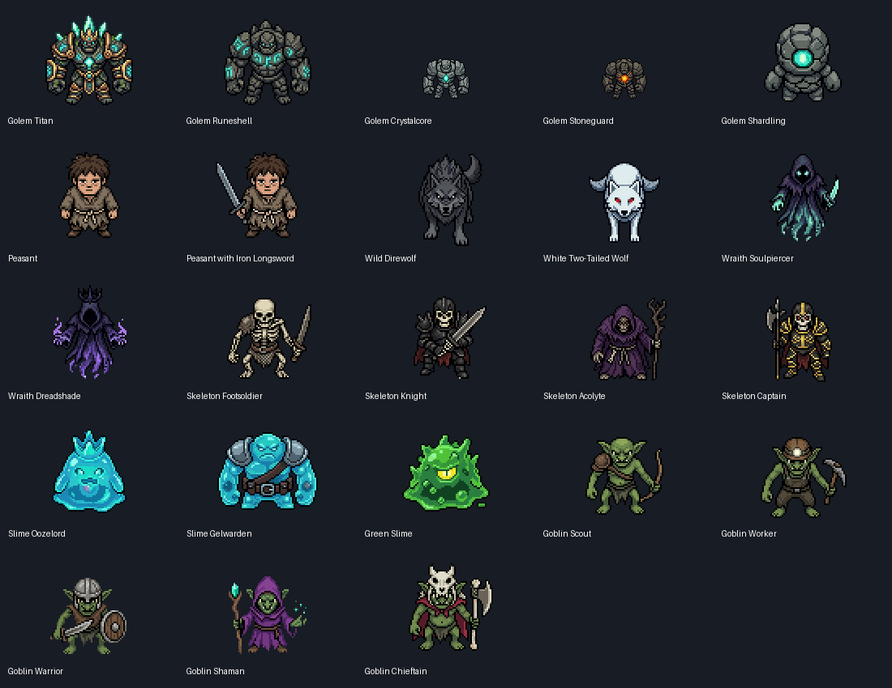

# Character sprite integration

The supplied export is integrated into the Godot game as **23 character skins**:
two player appearances and 21 creature appearances. The import contains **444
original PNGs**, consisting of 184 directional poses and 260 animation frames.
Every skin has all eight facing directions. **25 monster definitions** have
explicit artwork assignments; the remaining 58 definitions have no matching
supplied skin and retain the game's generic actor appearance.

The original `Desktop/Character Sprites` folder is read-only input. Its metadata
and image files are never edited. The synced project files under `sources/` are
also untouched. The game runs from local copies under
`godot_client/Assets/Characters/`, with its catalog in
`godot_client/data/character_sprites.json`.



## Try the sprites

Open `godot_client/project.godot` in Godot 4 and run the project.

- **W/A/S/D:** move and turn in eight directions. The peasant has a complete
  eight-direction run cycle. Player movement, map collisions and combat retain
  their existing gameplay behavior.
- **F7:** open the sprite viewer; gameplay pauses while the viewer is open.
  Select any of the 23 skins in the scrolling list, choose a facing and action,
  and inspect its crisp 3x preview. Walk plays continuously; attack repeats for
  inspection. **Test hit** flashes the sprite and **Target ring** previews
  selection feedback. The coverage text identifies actions using a static pose.
- **Spawn [monster] in game:** use this button in the viewer to spawn a creature
  with the selected skin and return to the game.
- **F5:** open the monster spawn menu. All 25 mapped monster templates are
  available. **Page Up/Page Down** change pages of ten templates; the menu shows
  template IDs.
- **F6 / I:** open the item menu / inventory. In the item menu, enter **25** and
  press Enter to equip **Iron Longsword** as a separate hand attachment. The
  player retains the regular peasant artwork and all eight walking directions.
  Other items need independent artwork registered in `equipment_visuals.json`.
- **Equipment preview:** in F7, select **Peasant**, choose **Iron Longsword**,
  and enable **Show attachment skeleton**. The supplied **Peasant with Iron
  Longsword** appearance remains a reference skin. See
  [`../godot_client/docs/EquipmentSockets.md`](../godot_client/docs/EquipmentSockets.md)
  for the frame-synchronized attachment skeleton and new-item workflow.
- **Your shield:** item **106**, **Adamantite Kiteshield**, uses the eight views
  decoded from your GIF with native transparency and unchanged pixels. In F7,
  choose it in the Shield picker independently of the test weapon. The shield
  follows the left hand and switches artwork only when facing changes.
- **T / U:** select the next target / clear the target. **Space** starts
  auto-chase and combat. Health bars remain above the visuals, selected actors
  get a ground ring, attacks trigger their action feedback, and damage flashes
  the struck actor.
- **Escape:** close the open menu.

The collision body stays at the actor's feet rather than following the weapon
or the full illustrated canvas. Drawing order follows ground position so actors
overlap sensibly. Sprites use nearest-neighbor texture filtering. Ground anchors
and display heights are recorded explicitly per skin, including the larger
Titan and smaller Shardling.

## What animation is actually supplied

The integration plays every supplied animation where its facing exists. A
missing animation uses the **same-facing directional pose**. It never plays a
south-facing walk while the actor is moving north, mirrors asymmetric equipment,
or claims that missing artwork was generated.

Missing attack artwork uses a short directional lunge and the existing combat
effects. Hit feedback is a temporary color flash. Death stops and dims the
visual; defeated monsters fade out and leave the active world. Those are
runtime feedback cues; the export contains no authored hit or
death animations. Sixteen of the 23 skins contain directional poses only.

| Skin | Supplied animated action | Directions | Frames per direction |
| --- | --- | --- | --- |
| Peasant | Run, used as walk | All eight | 8 |
| Peasant with Iron Longsword | Walk | South, north | 8 |
| Golem Titan | Attack | South, north, west | 9, 11, 11 |
| Golem Shardling | Walk | South | 8 |
| White Two-Tailed Wolf | Idle | All eight | 9 |
| Slime Gelwarden | Walk | South | 8 |
| Green Slime | Idle | North, south, east, southeast | 13 |

The wolf export contains two west-facing idle takes with suffixed direction
names. Both are preserved. The importer explicitly selects `west-5e3d6f1d` as
canonical west and retains `west-b799e8a2` in `exported_animations`. Thus the
260 imported animation images contain nine frames from an alternate take;
251 frames are selected by the runtime action catalog.

Animation canvases are often larger than pose canvases: for example the peasant
pose is 64x64 but its run frames are 76x76 or 80x80. Those original transparent
margins and pixel dimensions are preserved. The runtime centers each frame and
uses the shared skin ground anchor and a constant scale, avoiding a size change
when an action starts. The catalog's `frame_sizes` records actual dimensions.

## Explicit appearance assignments

| Stable skin ID | Monster templates / player use |
| --- | --- |
| `peasant` | Default player |
| `peasant_sword` | Supplied reference appearance, retained in F7; equipment now uses sockets |
| `goblin_scout` | Goblin Scout |
| `goblin_worker` | Goblin Worker |
| `goblin_warrior` | Goblin Warrior |
| `goblin_shaman` | Goblin Shaman |
| `goblin_chieftain` | Goblin Chieftain |
| `golem_shardling` | Golem Shardling |
| `golem_stoneguard` | Golem Stoneguard, Golem Boulderkin (shared stone armor appearance) |
| `golem_crystalcore` | Golem Crystalcore |
| `golem_runeshell` | Golem Runeshell |
| `golem_titan` | Golem Titan |
| `skeleton_footsoldier` | Skeleton Footsoldier |
| `skeleton_knight` | Skeleton Knight |
| `skeleton_acolyte` | Skeleton Acolyte |
| `skeleton_captain` | Skeleton Captain |
| `slime_caustic` | Slime Caustic, Slime Glob, Slime Puddle (shared green ooze appearance) |
| `slime_gelwarden` | Slime Gelwarden |
| `slime_oozelord` | Slime Oozelord |
| `wolf_direwolf` | Wolf Direwolf |
| `wolf_moonfang` | Wolf Moonfang, Wolf Elder Fang (shared white two-tailed appearance) |
| `wraith_soulpiercer` | Wraith Soulpiercer |
| `wraith_dreadshade` | Wraith Dreadshade |

Artwork is missing for every bandit, bat, cultist, harpy, kobold, orc, spider and
troll definition (48 templates). Within families represented by this export,
these ten templates also have no assigned skin: Skeleton Boneshard, Skeleton
Sniper, Slime Mimic, Wolf Cub, Wolf Hunter, Wolf Alpha, Wraith Echo, Wraith Shade,
Wraith Phantom and Wraith Sorrow. The complete machine-readable list is
`import_summary.unmapped_monsters` in the catalog.

## Reimport or verify

From the `aetheria-game` repository folder, use Python 3.10 or newer:

```powershell
python tools/import_character_sprites.py "C:/Users/Riptide/Desktop/Character Sprites"
python tools/import_character_sprites.py "C:/Users/Riptide/Desktop/Character Sprites" --check
```

The importer needs only the Python standard library. Add `--contact-sheet` to
regenerate the preview image when Pillow is installed. `--check` performs a
read-only comparison of the catalog and every imported PNG against the source.
Open Godot afterward so it can import newly copied image resources.

The importer reads states from both `groups[].states` and top-level `states`.
The supplied export repeats the same 23 states in both places; duplicate IDs
with identical data are deduplicated, and conflicting duplicates fail with an
error. Only PNGs referenced by those states are copied. Animation array order is
preserved; frame counts are never inferred from expected filenames. Missing
files, invalid PNGs, invalid directions, unsafe paths, ambiguous takes and stale
monster names fail validation. The importer does not delete existing assets.

Known character UUIDs map to stable, descriptive skin IDs in
`tools/import_character_sprites.py`. Update its explicit `KNOWN_STATES` entries
to assign new character artwork, monster names, authored animation roles,
display sizes or ground anchors. An unfamiliar character state is imported
under a stable UUID-derived ID without inventing a monster assignment. Its
unknown animation names are preserved and reported as unassigned until a role
is specified. Do not edit the generated catalog by hand: the next import
regenerates it.

Every import computes SHA-256 fingerprints before copying and verifies the
original metadata and every referenced source PNG again afterward. The current
export's recorded fingerprints are:

```text
metadata.json:
2e797bb85668862c219cb3ba1e745b398bf38ab956c6c0d930f176b8b27cf9b6
All referenced PNG paths and bytes:
bc8d6789f553e01342a6584523c1934e73f9cab353ce683503c152fa9901d06c
```

These values live in `import_summary.source_metadata_sha256` and
`source_assets_sha256`. The PNG fingerprint combines sorted relative paths and
each file's content hash, so changing an original image or its reference changes
the fingerprint. Repeating an unchanged import copies zero changed PNGs and
leaves the catalog byte-identical.

## Runtime verification

Validated in Godot 4.5.1 on October 18, 2026: **3,963 headless checks** and
**3,970 graphical checks** passed with clean error logs. Both game scenes were
checked for eight-way movement, all 25 mapped monster spawns, equipment changes,
combat feedback, targeting and death cleanup. The viewer was checked for real
keyboard input, action changes, spawning, pause behavior and F5 pagination.
The viewer, gameplay and spawn menu were also inspected in rendered screenshots.

Run these commands from the repository folder with your Godot executable:

```text
godot --headless --editor --path godot_client --import
godot --headless --path godot_client --script res://scripts/dev_tools/sprite_integration_smoke.gd
```
